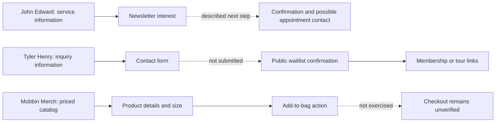
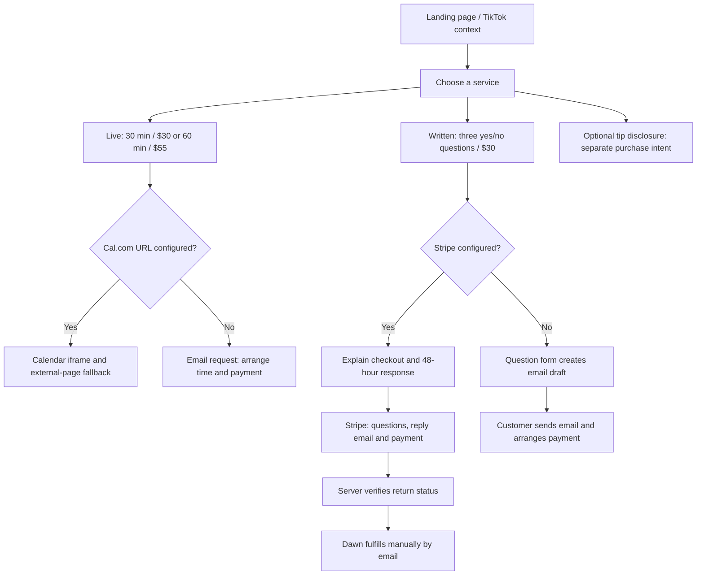

# DawnOfThePhoenix: conversion-flow review

Research date: October 27, 2026 (America/New_York). Repository baseline: [`8d2bf4c`](https://github.com/DavidEaton/DawnOfThePhoenix/commit/8d2bf4c639db6bfca70d42044a4204c0a498874f).

## What this review can establish

**Prioritize a clearer route from service choice to payment and fulfillment.** Dawn already has transparent prices, a personal introduction, booking and payment fallbacks, and verified Stripe return status. Improve those foundations before adding a quiz, membership, or larger storefront.

This is a **partial Mobbin study**, supplemented by direct public website research and a source-code audit. The requested [Mobbin web discovery page](https://mobbin.com/discover/apps/web/latest) returned navigation and login links, without app screens. No Mobbin connector was available in this session. Individual library captures, screen permalinks, visual layouts, and complete purchase flows could not be inspected. No psychic-medium entry in Mobbin was verified. The named mediums below are prominent examples, not a conversion-performance ranking.

The diagrams and wireframes are original analytical illustrations, **not screenshots or reproductions of Mobbin screens**. Text extraction establishes visible content and links, not responsive behavior, CSS implementation, analytics, conversion rates, or a completed transaction. No forms were submitted and no purchases were made. Search indexes can lag live pages.

## Mobbin evidence and transferable lessons

| Source | Observed evidence | Proposed application to Dawn |
| --- | --- | --- |
| [M1 — Web discovery](https://mobbin.com/discover/apps/web/latest) | Login shell; no inspectable library flows | Keep library-level research explicitly pending |
| [M2 — Mobbin onboarding study](https://mobbin.com/blog/the-long-onboarding-a-study-of-1-460-flows) | Describes Headspace offering a brief breathing experience early; contrasts immediate product access with lengthy personalization | Let visitors understand the experience before collecting information. Offer a concise, owner-approved explanation of a session |
| [M3 — Mobbin MCP examples](https://mobbin.com/mcp) | Annotates paywalls with price in the action and payment-objection microcopy; mentions ecommerce and booking references | Repeat the selected price and explain the external handoff at the action |
| [M4 — Mobbin research workflow](https://mobbin.com/blog/how-to-use-mobbin-mcp) | Describes using actual product flows to ground design decisions | Validate recommendations against full web captures when access becomes available |
| [M5 — Mobbin Merch catalog](https://merch.mobbin.com/) and [product](https://merch.mobbin.com/products/basic-tee-grey) | Catalog presents prices; product text includes size choices, details and an add-to-bag action | Place the service's format, duration, price and next action together. This is Mobbin's own shop, not a library capture |
| [M6 — Merch help](https://merch.mobbin.com/help) | Explains payment methods, dispatch, tracking, returns and support | Put fulfillment expectations and support close to the purchase decision; do not transplant physical-goods policies |
| [M7 — Mobbin payment help](https://help.mobbin.com/en/articles/691904) | Describes Stripe processing and conditional wallet availability for Mobbin subscriptions | Consider wallets only after checking Dawn's integration and eligibility; this does not prove they work in Dawn's checkout |

These observations support design hypotheses, not promised sales improvements. Mobbin's onboarding study explicitly distinguishes observed patterns from evidence of performance. Its app examples are not verified desktop-web booking flows. Dawn's code currently specifies card payment in Stripe; adding a wallet badge alone would be misleading.

## Direct medium-site comparisons: separate from Mobbin

| Site and source | Observed route | Lesson and limit |
| --- | --- | --- |
| [John Edward — private readings](https://johnedward.net/private-readings/) | Service information → newsletter registration with reading-interest selection → confirmation → possible future appointment contact | Distinguishes expressing interest from obtaining an appointment. Useful when Dawn is unavailable; not a reason to add a waitlist to an available calendar |
| [Tyler Henry — inquiry](https://www.thetylerhenrymedium.com/inquire-about-a-private-reading/) | Explains inquiry handling → contact/location fields → submit | State who responds and what happens next. Dawn does not need these location fields for a written reading |
| [Tyler Henry — public confirmation page](https://www.thetylerhenrymedium.com/private-reading-inquiry-confirmation/) | Waitlist confirmation → membership and tour options | Clear status can precede another offer. This page was opened directly; the form-to-confirmation transition was not exercised |

These celebrity businesses route scarce personal availability into inquiries or other products. Dawn's $30/$55 offerings have a different operating model. Preserve straightforward booking and written-reading checkout; avoid copying celebrity scarcity messaging or implying a guaranteed spiritual connection.

## Visual comparison of the decision paths

Observed content is solid; dashed arrows mark transitions not exercised.



### Dawn's current flow, from code



A configured URL or nonempty key signals readiness in code; it does not establish working provider accounts or successful transactions.

## Project audit and priorities

Paths below are relative to the repository root. Findings are code observations, not a live production audit.

| Priority | Evidence in current project | Recommendation | Acceptance and verification |
| --- | --- | --- | --- |
| P0 — consistent instructions | `Pages/Index.cshtml` FAQ described only email payment although `wwwroot/js/readings.js` can open Stripe. Process copy omitted when the response clock starts | Explain both paths; use 48 hours **of payment** consistently | Published home page describes Stripe and email in both Stripe configurations. Included in this branch |
| P0 — activation before promotion | `Configuration.cshtml.cs` treats nonempty Stripe key as ready; booking uses configured Cal.com slugs | Verify event prices, availability, timezone, test-mode checkout, receipts and merchant notifications using README/Azure setup | Owner verifies both live durations and written questions/reply email. No live transactions performed here |
| P1 — clearer primary choice | Hero `data-book="choose"` goes to the Cal.com profile or live-session email choices; written reading is available through `#ask` farther down | Route “Find your session” to the three service cards, or offer all three in the chooser | Every primary chooser exposes both live durations and written reading; preserve direct card actions and keyboard navigation |
| P1 — one source of home content | `Index.cshtml` inlines most sections; README previously directed edits to companion `Pages/Home/` partials. `_Hero.cshtml` references absent `phoenix-spirit.webp`, while the rendered page uses `PhoenixCircle.webp` | Replace inline sections with corrected partials in a dedicated follow-up; preserve section order and asset paths | Compare rendered headings, anchors, all CTAs and images before/after; request each rendered asset from publish output |
| P1 — handoff reassurance | `booking.js` shows a calendar without a selected-service summary; service prices exist on cards | Carry duration and price into the dialog and explain Cal.com handles time/payment | No price or duration mismatch for either event; verify external fallback and unavailable-calendar states |
| P1 — reliable no-JavaScript path | Reading actions are buttons bound by modules; email fallback still needs JavaScript | Add a visible contact link near service cards and a useful `noscript` explanation | Disable JavaScript and confirm visitors can request help; do not imply a booking was submitted |
| P2 — trust through expectations | Personal biography, preparation FAQ, terms and disclaimers already exist | Add Dawn-approved session format, location/video details and short introduction; obtain explicit consent for any authentic testimonials | No invented reviews, credentials, outcome claims, or popularity figures; confirm mobile readability |
| P2 — accessible dialogs | Native dialog exists; dynamically inserted headings have no shared accessible naming relationship | Name dialog from its current heading, manage initial focus, and verify focus restoration on close | Keyboard and screen-reader QA across chooser, email, checkout and payment-return states |
| P2 — recoverable fulfillment | Payment return verifies Stripe status; fulfillment is manual, and uncertain status advises against paying again | Add clear support action on uncertain status and cancellation; confirm merchant workflow can meet 48 hours | Mock paid, unpaid, cancelled and provider-error paths; no extra payment to recover an uncertain result |
| P3 — measure before expanding | No funnel instrumentation found in browser modules | Add minimal, privacy-reviewed events for service selection, handoff and provider-confirmed outcomes | Never record questions, email, card details or session IDs; distinguish click-through from completed purchase |

`Pages/` and `wwwroot/` in this table refer to `DawnOfThePhoenix.Web/`. The existing collapsed tip jar is appropriate secondary content and should remain separate from paid-reading actions. Keep current prices and payment recipients.

### Proposed service-choice wireframe

Original proposal, not an observed competitor layout:

```text
┌────────────────────────────────────────────────────────────┐
│ Choose your reading                                        │
│ A focused conversation, more time, or a reply by email.      │
├──────────────────┬──────────────────┬──────────────────────┤
│ LIVE             │ LIVE             │ WRITTEN              │
│ 30 minutes       │ 60 minutes       │ 3 yes/no questions   │
│ $30 USD          │ $55 USD          │ $30 USD              │
│ Focused session  │ More to explore  │ Email within 48 hours│
│                  │                  │ of payment           │
│ [Choose a time]  │ [Choose a time]  │ [See checkout steps] │
├──────────────────┴──────────────────┴──────────────────────┤
│ Review format, payment and terms before confirming.         │
│ Questions? Email Dawn.                                      │
└────────────────────────────────────────────────────────────┘
```

Stack the cards on narrow screens. Show configured/unavailable booking guidance truthfully. Preserve the existing secure payment backend; a storefront cart adds little value for these independent services.

## Measurement and follow-up research

Start with service-card selection → provider handoff → confirmed purchase/booking, segmented by service and mobile/desktop. The website can observe handoffs; confirmed Cal.com bookings need provider reporting or an approved integration. Stripe return visits alone miss purchasers who never return. Use verified provider totals to reconcile outcomes. Compare an established baseline with the clearer chooser; traffic volume determines whether a controlled experiment is practical. No uplift target is asserted without data.

To complete the requested Mobbin library study, connect authenticated Mobbin access or supply exported captures with their original links. Inspect at least one relevant wellness flow, one booking flow, and one ecommerce flow on **web**. Record app name, capture date, every screen/flow permalink, service selection, price visibility, handoff, cancellation, confirmation, desktop/mobile differences and accessibility observations. Verify whether psychic/medium entries exist rather than assuming coverage. Replace pending sections with actual evidence before describing this as a complete Mobbin visual benchmark.

## Changes and checks in this branch

The branch adds this report, corrects the rendered FAQ/process timing and companion partials, clarifies README editing guidance, and extends the existing published-application smoke checks. Prices, recipients, checkout transport, and deployment configuration are unchanged. Test instructions remain in `tests/deployment/README.md` and `tests/DawnOfThePhoenix.Checks/README.md`.

Git transport could not reach the environment proxy. GitHub's connected API resolved latest `main` to the baseline SHA above, already present locally; the stale `origin/main` reference was synchronized to that commit before creating the final branch state. Main was not edited. Validation results and publication details are recorded in the PR.
